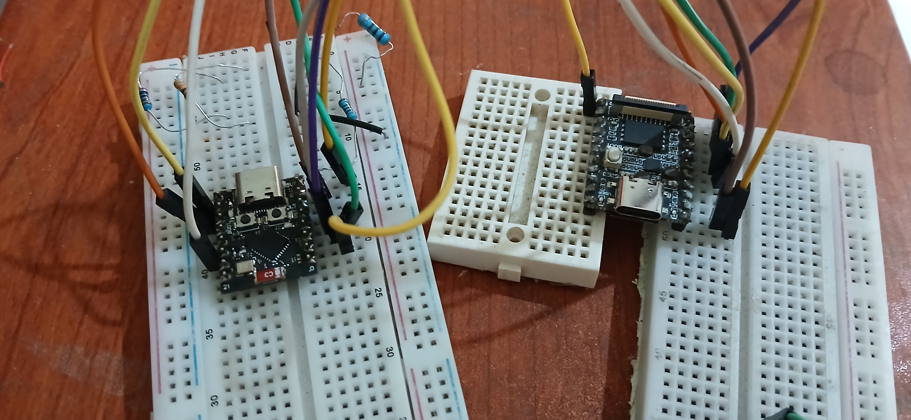

# Luckfox Pico Mini B + ESP32-C3 SuperMini SPI Wi-Fi

The Luckfox Pico Mini B (Rockchip RV1103) has no wireless. This project turns an ESP32-C3 SuperMini into its Wi-Fi adapter over SPI using [ESP-Hosted](https://github.com/espressif/esp-hosted). Linux gets a normal `wlan0`, so `wpa_supplicant`, `udhcpc` and `sshd` work as usual.

Power the Luckfox, wait about 15 seconds, and `ssh root@<board-ip>` works over Wi-Fi.



**Full build guide:** [ESP32C3 WiFi Driver for Luckfox Pico Mini](https://accidentalantenna.pages.dev/projects/luckfox-esp32-c3-spi-wifi/) on [AccidentalAntenna](https://accidentalantenna.pages.dev). It has the pinout images, every problem I hit and the throughput measurements. This README is the short version.

## How it works

- **ESP32-C3 (SPI slave):** runs the Wi-Fi stack and forwards Ethernet frames and control commands over SPI.
- **Luckfox (SPI master):** runs the `esp32_spi.ko` kernel module, which registers with `cfg80211` as a standard Wi-Fi device.
- **Extra GPIOs:** Handshake (ESP32 is ready for a transfer), Data Ready (ESP32 has a frame for the host) and Reset (the host resets the ESP32).

## Hardware

| Part | Notes |
| --- | --- |
| Luckfox Pico Mini B | RV1103, about 33 MB usable RAM, SPI NAND |
| ESP32-C3 SuperMini | Other ESP32-C3 boards work; the pins below are for the SuperMini |
| 2 × 10 kΩ resistors | Pull-ups on CS and on ESP32 GPIO2 (MISO) |
| Jumper wires, breadboard | Keep the SPI wires short |

## Wiring

| Signal | Luckfox pin | Luckfox GPIO | ESP32-C3 pin |
| --- | --- | --- | --- |
| Power | 1 (VBUS) | n/a | 5V |
| Ground | 2 (GND) | n/a | G |
| CS | 6 | GPIO1_C0 | GPIO10 |
| SCLK | 7 | GPIO1_C1 | GPIO6 |
| MOSI | 8 | GPIO1_C2 | GPIO7 |
| MISO | 9 | GPIO1_C3 | GPIO2 |
| Handshake | 10 | GPIO1_C4 | GPIO3 |
| Data Ready | 11 | GPIO1_C5 | GPIO4 |
| Reset | 12 | GPIO1_D0 | GPIO1 |

- **Power the SuperMini from VBUS (pin 1) into its 5V pin, not from 3V3.** From the Luckfox 3.3 V pin the ESP32 browns out when its radio starts: the boot event arrives, then the first command times out.
- **CS pull-up:** 10 kΩ from CS to 3.3 V, so the ESP32 sees CS idle while the Luckfox boots.
- **GPIO2 pull-up:** 10 kΩ from ESP32 GPIO2 (MISO) to 3.3 V. GPIO2 is a strapping pin. This is cheap insurance; my build worked without it.
- **Reset:** the SuperMini has no EN pin on its header, so the firmware watches GPIO1 instead (see below).

## Repository layout

| Path | Contents |
| --- | --- |
| `dts/` | Device tree `rv1103g-luckfox-pico-mini-esp32.dts`: enables SPI0 and describes the ESP32 node. Includes the stock Mini DTS. |
| `patches/` | `esp-hosted-linux.patch` and `esp_luckfox_compat.c` on top of the espressif/esp-hosted commit in `esp-hosted-linux.commit`. |
| `bundle/` | Board scripts: `S98esp32wifi` (init script), `insmod_ko.sh` (slimmed boot), `board_bringup.sh`, `flash_esp32c3.sh`, and the benchmark helpers `run.sh` and `tp.py`. Build outputs placed here are gitignored. |
| `backup/` | `mtd3-boot-backup.bin`, a backup of the stock boot partition from my board. |

## Build

You need the [Luckfox Pico SDK](https://github.com/LuckfoxTECH/luckfox-pico) (kernel 5.10.160) and [ESP-IDF](https://docs.espressif.com/projects/esp-idf/) v6.1.

```sh
git clone https://github.com/pahasara2003/luckfox_esp_wifi
cd luckfox_esp_wifi
git clone https://github.com/espressif/esp-hosted esp-hosted-linux
cd esp-hosted-linux
git checkout $(cat ../patches/esp-hosted-linux.commit)
git apply ../patches/esp-hosted-linux.patch
cp ../patches/esp_luckfox_compat.c host/
cd ..
```

### 1. Boot image with the device tree

Copy the DTS into the SDK at `sysdrv/source/kernel/arch/arm/boot/dts/`, then:

```sh
cd ~/luckfox-pico
export PATH=$PWD/sysdrv/tools/pc/uboot_tools:$PATH   # mkimage
make O=$PWD/sysdrv/source/objs_kernel -C sysdrv/source/kernel \
  ARCH=arm CROSS_COMPILE=arm-rockchip830-linux-uclibcgnueabihf- \
  rv1103g-luckfox-pico-mini-esp32.img \
  BOOT_ITS=$PWD/sysdrv/source/kernel/boot.its -j$(nproc)
```

### 2. Host kernel module

```sh
cd esp-hosted-linux/host
make target=spi LUCKFOX_COMPAT=y \
  -C ~/luckfox-pico/sysdrv/source/objs_kernel M=$PWD \
  ARCH=arm CROSS_COMPILE=arm-rockchip830-linux-uclibcgnueabihf- modules
arm-rockchip830-linux-uclibcgnueabihf-strip --strip-debug esp32_spi.ko
```

`LUCKFOX_COMPAT=y` adds `esp_luckfox_compat.c`, which stubs Bluetooth symbols this kernel lacks and imports the VFS namespace the driver needs.

**Strip the module.** Unstripped, `esp32_spi.ko` and `cfg80211.ko` total about 7 MB, and copying them into the board's RAM-backed `/tmp` triggered the out-of-memory killer. Stripped they are 140 KB and 225 KB.

Also take `net/wireless/cfg80211.ko` from the same kernel build. The stock one on the board crashes (Oops in `nl80211_pre_doit`) when `wpa_supplicant` talks to the ESP32.

### 3. ESP32-C3 firmware

```sh
cd esp-hosted-linux/esp/esp_driver/network_adapter
idf.py set-target esp32c3
idf.py build
idf.py -p /dev/ttyACM0 flash
```

The patch makes three firmware changes:

- **SPI mode 3**, to match `spi-cpol; spi-cpha;` in the device tree. ESP-Hosted's default mode 2 made every frame arrive one bit late.
- **Reset on GPIO1:** a GPIO interrupt latches the host's 0.2–0.5 ms low pulse, and the firmware restarts when the line goes high again. Polling every 5 ms missed the pulse. Unlike a real EN wire, this cannot revive a frozen ESP32.
- **No Wi-Fi power save:** the host's power-save request maps to `WIFI_PS_NONE`. In modem sleep the ESP32 missed broadcast ARP requests, so the board joined Wi-Fi but was unreachable until it sent traffic itself.

## Install on the board

Reach the board over USB (`ssh root@172.32.0.93`; the PC side is `172.32.0.100`).

**Back up, then flash the boot partition:**

```sh
cat /dev/mtd3 > /tmp/boot-backup.bin   # copy this off the board
flash_erase /dev/mtd3 0 0
nandwrite -p /dev/mtd3 /tmp/boot.img
reboot
```

The boot partition is 4 MB. After the reboot, `cat /proc/device-tree/model` should print `Luckfox Pico Mini (ESP32 SPI WiFi)`.

**Install the modules and the init script:**

```sh
cp /oem/usr/ko/cfg80211.ko /oem/usr/ko/cfg80211.ko.stock
cp cfg80211.ko esp32_spi.ko /oem/usr/ko/
cp bundle/S98esp32wifi /etc/init.d/
```

**Add your network** to `/etc/wpa_supplicant.conf` and make it readable only by root:

```sh
cat >> /etc/wpa_supplicant.conf <<'EOT'
network={
    ssid="YOUR_SSID"
    psk="YOUR_PASSWORD"
}
EOT
chmod 600 /etc/wpa_supplicant.conf
```

On boot, `S98esp32wifi` loads `cfg80211.ko` and `esp32_spi.ko`. Loading the module resets the ESP32 through pin 12, so it sends its boot event. The script then waits for `wlan0`, runs `wpa_supplicant` and `udhcpc`. Its log is `/tmp/esp32wifi.log`.

To try it by hand without the init script, copy `bundle/` to the board and run `./board_bringup.sh <ssid> <psk>`. Reset the ESP32 right after `esp32_spi` loads, because it sends its boot event only once.

### Optional: free up RAM

`bundle/insmod_ko.sh` replaces `/oem/usr/ko/insmod_ko.sh` with a no-op that skips the camera, ISP, NPU, video codec, audio and stock Wi-Fi modules. Keep the original as `insmod_ko.sh.stock`.

| | Stock | Slimmed |
| --- | --- | --- |
| RAM available | 11.5 MB | 15.2 MB |
| Load average | about 10 | 0.2 |
| Kernel modules | 20 | 2 |

`adbd` is kept. The high stock load average came from idle media kernel threads, not CPU use.

## Known issues and workarounds

- **First MISO bit reads 1.** In mode 3 the first bit of every transfer came in as 1, so byte 0 read `0x83` instead of `0x03`. The host driver clears bit 7 of RX byte 0 (the interface number never exceeds 7). This is a workaround; the root cause is still open.
- **2.4 GHz and 5 GHz.** The ESP32-C3 is 2.4 GHz only. If your PC is on 5 GHz, some routers will not pass traffic between the bands (check "AP isolation"). Put both on 2.4 GHz.
- **Boot event is sent once.** If the ESP32 boots before the driver loads, the event is lost. The reset wire and the GPIO1 firmware patch cover that case.

## Results

- `wlan0` comes up about 15 seconds after power-on. Five cold starts in a row connected and accepted SSH.
- It joins WPA2-PSK (802.11 b/g/n, 2.4 GHz channel 11), gets an address over DHCP and reaches the internet.
- TCP throughput by SPI clock, 10 seconds of raw TCP between the Luckfox and a PC, signal −62 to −65 dBm:

| Requested | Actual SPI clock | Download | Upload | Ping (avg) |
| --- | --- | --- | --- | --- |
| 2 MHz | 1.98 MHz | 1.7 Mbit/s | 1.6 Mbit/s | 52 ms |
| 5 MHz | 4.95 MHz | 3.9 Mbit/s | 3.8 Mbit/s | 25 ms |
| 10 MHz | 9.9 MHz | 6.9 Mbit/s | 6.9 Mbit/s | 21–36 ms |
| 20 MHz | 19.8 MHz | 10.9 Mbit/s | 10.8 Mbit/s | 25 ms |
| 30 MHz | 24.75 MHz | 11.5 Mbit/s | 9.5 Mbit/s | 13 ms |

Throughput levels off around 11 Mbit/s above 20 MHz, limited by the ESP32-C3's single core and the handshake between transfers. No checksum or RX errors at any speed, even on breadboard jumpers. Range, power draw and long-term stability at the higher clocks were not measured.

The device tree ships capped at 10 MHz. To test other clocks without rebuilding the kernel, the patched driver has a `spi_max_mhz` option:

```sh
insmod esp32_spi.ko spi_max_mhz=20
```

`bundle/run.sh <MHz>` reloads the driver at a clock and runs the measurements with `bundle/tp.py`. It has my IP addresses hard-coded, so edit them first.

## What I'd change

- Find the cause of the first-bit problem with a logic analyser on CS, SCLK and MISO.
- Raise the default SPI clock to 20 MHz.
- Use a real EN wire so a frozen ESP32 can be recovered.
- Move it to a small carrier board with short traces and a bulk capacitor on the ESP32 supply.

## Related

The same SPI0 wires also drive an ILI9341 display with my [C++ display driver](https://github.com/pahasara2003/luckfox_tft_ili9341). Do not use both on one `spi0.0` at once; disconnect the ESP32 first.
